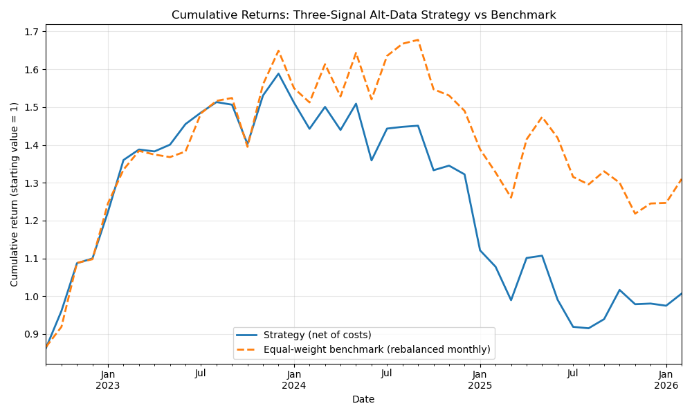
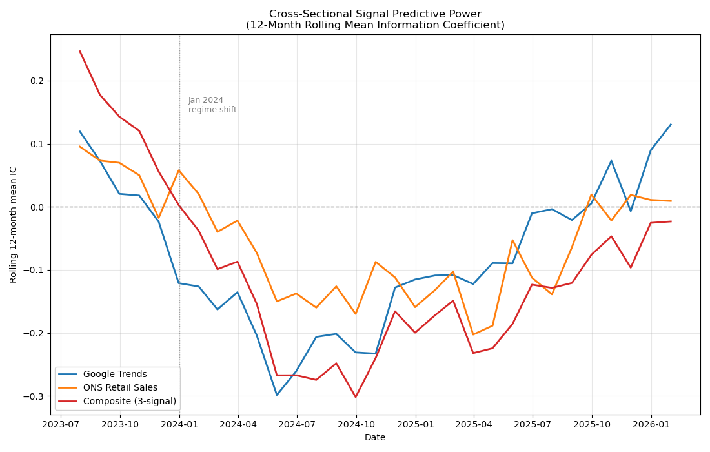

# UK Consumer Alt-Data Strategy

A systematic long-only equity strategy on UK consumer stocks, using three alternative data sources (Google Trends search volume, UK port freight statistics, and ONS retail sales indices) to generate monthly signals. Personal project.

## At a glance

- **7 UK consumer stocks**, monthly rebalancing, long-only top-3
- **Three alternative data sources**, Google Trends search interest, DfT port freight statistics, and ONS retail sales indices
- **42-month backtest** with 20bp monthly transaction cost
- **Result.** Net Sharpe 0.13 against 0.44 for an equal-weight benchmark rebalanced monthly. The strategy underperformed. A per-signal IC diagnostic shows the signals turning anti-predictive through 2024 before recovering in 2025, full analysis below.

## Hypothesis

Consumer stock returns should be predictable, in part, from three publicly observable inputs.

1. **Consumer attention.** If search interest in a brand is unusually high against its recent history, this may lead its share price.
2. **UK import activity.** If UK inbound container tonnage is unusually high, this may signal broader consumer demand strength.
3. **Retail sales momentum.** If a stock's category (food, clothing, household) shows unusually strong year-on-year sales growth, that momentum may persist into next-month returns.

The strategy tests whether combining these signals into a composite score, and holding the top-ranked stocks monthly, beats a naive equal-weight benchmark.

## Universe

Seven FTSE-listed UK consumer stocks, chosen for meaningful UK brand recognition and a mix of sub-sector exposure.

| Ticker | Company | Sub-sector | ONS category |
|---|---|---|---|
| GRG.L | Greggs | Food-to-go | Food stores |
| NXT.L | Next | Apparel & home | Clothing |
| JD.L | JD Sports | Sportswear | Clothing |
| DOM.L | Domino's Pizza UK | Restaurant delivery | Food stores |
| JDW.L | JD Wetherspoon | Pubs | Food stores |
| BME.L | B&M European | Discount retail | Household goods |
| MKS.L | Marks & Spencer | Food & clothing | Food stores |

## Data sources

- **Prices.** yfinance, 5 years of daily data, resampled to month-end.
- **Google Trends.** Manually exported CSVs (trends.google.com) covering the past five years, UK region, brand-name search terms. Data is monthly frequency due to Google's default aggregation for multi-year queries. Google scales each series from 0 to 100 against the maximum in the download window, which uses information from later dates, but a rolling z-score is unaffected by a constant rescaling, so this introduces no lookahead beyond integer rounding.
- **UK port freight.** DfT PORT0502 quarterly statistics (gov.uk open data). Inbound tonnage across five container-heavy UK ports (Felixstowe, London, Southampton, Grimsby & Immingham, Liverpool). Each quarter is aligned to its publication date, roughly three months after quarter end, before forward-filling to monthly frequency.
- **ONS retail sales.** UK Office for National Statistics Retail Sales Index (dataset ID DRSI), automated download via the ONS API. Chained volume year-on-year percentage change, seasonally adjusted, at category level (food, clothing, household). Each stock is mapped to the category most relevant to its business. Data is lagged by 1 month to reflect the ONS publication schedule and avoid lookahead bias.

## Method

1. Load and clean each data source into `data/processed/`.
2. Combine into a single monthly dataset (`master_dataset.csv`).
3. For each stock, compute a 12-month rolling z-score of Google Trends search interest.
4. Compute a 12-month rolling z-score of UK container port inbound tonnage (macro signal, same for all stocks).
5. For each stock, compute a 12-month rolling z-score of its mapped ONS category year-on-year growth.
6. Take the equal-weighted average of the three z-scores as the composite score.
7. Each month, hold the top three stocks by composite score, equal-weighted. Rebalance monthly at month-end.
8. Apply a 20bp transaction cost per month as a rough allowance for rebalancing turnover.
9. Compare against an equal-weight benchmark of the same seven stocks, rebalanced monthly back to equal weights.

## Results

**Sample period.** September 2022 to February 2026, 42 monthly returns after the 12-month burn-in for rolling signals. The backtest and the information coefficient analysis cover the same 42 months, since each month's return is earned on positions set from the previous month's signals.

| Metric | Strategy (net) | Equal-weight benchmark (rebalanced monthly) |
|---|---|---|
| Annualised return | 0.20% | 8.02% |
| Annualised volatility | 23.73% | 23.23% |
| Sharpe ratio | 0.13 | 0.44 |
| Maximum drawdown | -42.4% | -27.4% |
| Hit rate (positive months) | 57.1% | 54.8% |

Return figures are geometric (compounded). The Sharpe ratio annualises the arithmetic mean monthly return at a zero risk-free rate. The two differ materially here. The strategy's arithmetic annualised mean is about 3.1% (a Sharpe of 0.13 times 23.7% volatility) against a compounded 0.20%, a variance drag of roughly 2.9 percentage points driven by the high volatility and the 42% drawdown.

The strategy tracked the benchmark closely through late 2023, which is expected for a portfolio holding three of the same seven stocks, with only a modest lead in spring and summer 2023. From early 2024 it fell behind and the gap widened through 2025. A higher hit rate alongside a lower return means the winning months were small and the losing months were large.



*Cumulative returns. Strategy (solid line) against the equal-weight benchmark rebalanced monthly (dashed).*

## Interpretation

The signal diagnostic tests each signal individually and as a composite, measuring the cross-sectional information coefficient (IC), the month-by-month correlation between signal values and next-month returns across the 7 stocks.

**Port freight is excluded from the per-signal IC analysis.** It is a macro signal, so the same value applies to all seven stocks in any given month and cross-sectional IC is undefined by construction. Because the strategy is long-only and always holds the top three stocks equally, a signal that shifts every stock's score by the same amount changes neither which stocks are held nor how much is invested. In this design the port freight signal has no effect on which stocks are held. It also leaves the composite IC unchanged, since adding the same value to every stock does not change a cross-sectional correlation. A production system would use it as a separate market-timing input that scales overall exposure, rather than inside the ranking.

| Signal | Full-sample IC | Pre-Jan 2024 IC (17 months) | Post-Jan 2024 IC (25 months) |
|---|---|---|---|
| Google Trends | +0.014 | +0.015 | +0.014 |
| ONS Retail Sales | -0.038 | +0.026 | -0.081 |
| Composite | -0.030 | **+0.085** | **-0.109** |



*12-month rolling mean IC for each signal. All three fell together through 2024 and recovered through 2025, with Google Trends recovering furthest.*

### What the diagnostic shows

The signals were modestly predictive in 2023, fell together into clearly negative territory through 2024, and recovered through 2025. Google Trends recovered furthest and ended as the strongest of the three, while the composite finished just below zero.

The simple split at January 2024 hides this for Google Trends. Its post-2024 mean of +0.014 matches its pre-2024 mean, but only because a deep 2024 trough and a strong late-2025 recovery cancel out. ONS and the composite show a clear shift on both measures. The composite amplified the swings in both directions because its components moved together rather than adding independent information.

### Why the signal likely broke down

With only 42 observations no explanation can be proved, but the timing is consistent with a change in what actually drove UK consumer stock returns.

Through 2022 and most of 2023, the Bank of England was still hiking (peaking at 5.25% in August 2023) and consumer stocks moved primarily on operational fundamentals such as retail sales, footfall and brand momentum. The signals here measure exactly that, and had modest positive predictive power in that period.

From late 2023 the narrative shifted. Cuts were repeatedly deferred as inflation stayed sticky, and consumer stocks became rates-sensitive plays rather than earnings-driven ones. Then in October 2024 the Autumn Budget announced a large increase in employer National Insurance contributions taking effect in April 2025, hitting exactly the retailers, pubs and restaurants in this universe on cost structure regardless of top-line demand.

Once the market started pricing consumer stocks on rate expectations and cost inflation rather than on demand strength, signals that measure demand strength lost their edge. A retailer with strong Google Trends and rising ONS food sales could still get sold if its wage bill was about to jump or if a rate cut got pushed back. The 2025 recovery is consistent with those drivers easing, but it is too short and too dependent on a few months to confirm.

### Why the natural fix is not simply "switch signals"

A naive response is to switch to a different signal in early 2024 when the IC turned. This is exactly the wrong lesson. On 31 January 2024 no live investor knew a regime shift had begun. The rolling ICs sat close to zero and were only starting to turn, becoming clearly negative from spring 2024. Even then a negative rolling IC cannot distinguish a regime change from a bad patch. The 2025 recovery shows the cost of treating it as a regime change, since an investor who dropped Google Trends in mid-2024 would have abandoned it shortly before it recovered. Any switch designed knowing what happened next is in-sample optimisation. It fits the backtest to the exact history observed and would fail live.

The professional approach is either (a) a multi-signal ensemble with dynamic weighting across many independent signals, or (b) an explicit regime-detection model that predicts the current market driver. Both need far more data and signals than this project has.

The realistic next iteration is a further signal that captures the driver the market switched to, SONIA futures or gilt yield changes as a rates factor, so the composite has exposure to both demand momentum and rates. That would let the strategy adapt to whichever driver is dominant without fitting to observed regime breaks.

### Two competing readings of the pre-2024 composite IC of +0.085

- **Favourable.** The signals genuinely captured consumer momentum in a period when that mattered, and the shift to a negative IC reflects the macro drivers described above.
- **Skeptical.** With 17 pre-period months, +0.085 could arise from noise. The recovery in late 2025 could be a re-emergence of signal or continued noise. Distinguishing between them requires more data.

Both readings are defensible. With 42 total observations, no result should be treated as robust.

## Limitations

- **Sample size.** The analysis rests on 42 monthly returns. Confidence intervals on the Sharpe ratio and the information coefficients are correspondingly wide, and any covariance or correlation estimate built on this few points is fragile. The fragility is directly visible. Adding a single month, February 2026, moved the Google Trends full-sample IC from -0.001 to +0.014 and turned its post-2024 mean from negative to positive. None of the point estimates should be treated as precise.
- **Trends frequency.** Google Trends returned monthly data for the multi-year query. Weekly Trends data, achievable with rolling shorter queries stitched together, would materially increase sample size.
- **Port freight is macro-uniform.** The same value applies to all stocks, so it cannot change the ranking, and because the portfolio is always fully invested it cannot change exposure either. Using it properly would need a separate rule that scales exposure up or down.
- **ONS category mapping is coarse.** Wetherspoons and Domino's are mapped to food stores, but their businesses (pub food, pizza delivery) are only loosely related to the retail food category ONS tracks.
- **Universe is small and UK-focused.** Extending to a broader FTSE 250 consumer basket would improve statistical power.
- **Transaction costs are a rough approximation.** The 20bp cost is charged every month regardless of actual turnover, and the benchmark carries no costs. A production version would model bid-ask spreads, stamp duty and slippage per trade.
- **Backtest is not live.** No paper trading has been run. Results are historical simulation only.

## Extensions

- **Rates factor** (SONIA futures or 2Y gilt yield changes) to add exposure to whichever driver is currently dominant, demand momentum or rates sensitivity
- Weekly Google Trends via rolling shorter queries, stitched together, to increase sample size from 42 to around 180 observations
- Broader universe (FTSE 250 consumer names) for better cross-sectional differentiation
- Long-short version with market-neutral construction
- Multi-signal ensemble with dynamic weighting once the signal count is high enough to support it

## How to run

Requires Python 3.11+ and the libraries listed in `requirements.txt`.

```bash
pip install -r requirements.txt
python src/pull_prices.py       # pull yfinance price data
python src/load_trends.py       # load manually exported Google Trends CSVs
python src/load_port_data.py    # load DfT port freight ODS file
python src/load_ons_data.py     # download and process ONS retail sales
python src/build_dataset.py     # combine into master monthly dataset
python src/backtest.py          # run backtest, produce equity curve
python src/diagnostic.py        # per-signal IC diagnostic
```

Google Trends CSVs must be manually downloaded from trends.google.com (5-year queries, UK region) and placed in `data/raw/` as `[ticker]_trends.csv`.

The DfT port freight ODS must be downloaded from gov.uk (PORT0502 quarterly data) and placed at `data/raw/port0502.ods`.

ONS retail sales data downloads automatically via the API on first run.

## Repository structure

```
uk-consumer-alt-data/
├── README.md
├── requirements.txt
├── data/
│   ├── raw/               (source data)
│   └── processed/         (cleaned datasets)
├── src/
│   ├── pull_prices.py
│   ├── load_trends.py
│   ├── load_port_data.py
│   ├── load_ons_data.py
│   ├── build_dataset.py
│   ├── backtest.py
│   └── diagnostic.py
└── outputs/
    ├── equity_curve.png
    ├── signal_diagnostic.png
    └── strategy_returns.csv
```

## Changelog

- **31 October 2026.** Removed the first month of the backtest, in which the strategy held no position but was still charged the 20bp cost while the benchmark took that month's full return. The benchmark fell sharply that month, so the error had flattered the strategy's relative performance. Realigned the quarterly port freight data to its publication date, since it had previously been used up to five months before release. Because port freight shifts every stock's score equally, this changed no holdings and no monthly return, which was confirmed by diffing the strategy return series. The earlier alignment had cut the sample one month short, so February 2026 now enters. Relabelled the benchmark as equal-weight rebalanced monthly rather than buy-and-hold, with no change to its calculation. Headline Sharpe ratios are now 0.13 against 0.44 over September 2022 to February 2026, previously 0.08 against 0.21 over August 2022 to January 2026.

## Disclaimer

This project is for educational purposes and personal skill development. It is not investment advice. Past performance in any backtest does not indicate future returns.